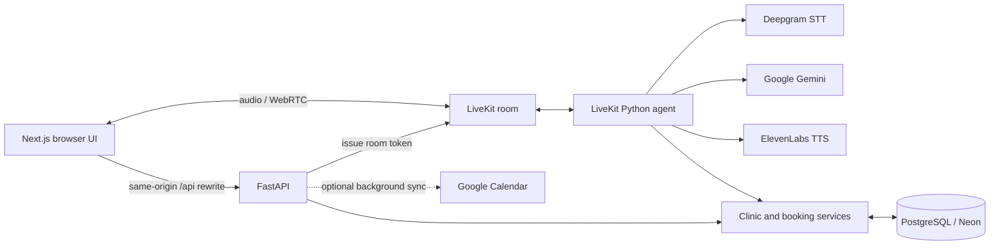

# Voxora

**A browser-based AI voice receptionist for a single dental clinic.** Voxora combines a real-time voice agent with a transactional appointment engine and an owner dashboard. The included clinic is the fictional BrightSmile Dental Clinic.

A caller can ask about clinic information, check availability, and request a booking, reschedule, cancellation, or human assistance. The system reads appointment changes back and requires a separate confirmation before committing them. The owner can manage clinic configuration, inspect calls and appointments, and optionally connect Google Calendar.

> **Status:** Portfolio / prototype, not a production-ready medical or telephone system. Live voice, deployment, and isolated PostgreSQL race tests still require verification in the target environment. The handoff is a simulated transfer, not a real phone transfer. Do not use real patient data without a security, privacy, clinical-safety, and operational review.

## Product walkthrough

1. Open `/voice`, start a conversation, and grant microphone access. The UI shows connection and agent states; the browser joins a LiveKit room with a short-lived token from FastAPI.
2. Ask about clinic hours or availability. The agent uses clinic data and tools, rather than relying only on its prompt.
3. Request an appointment. The backend checks availability, creates a proposal, and reads it back. A later affirmative caller turn is required before confirmation; availability is checked again when committing.
4. For an existing appointment, the caller must go through the implemented verification workflow before proposing changes. The agent can also escalate to a simulated human handoff.
5. Sign in at `/dashboard` to review appointments and calls, edit clinic settings, toggle new receptionist sessions, and optionally connect a Google Calendar. Disabling the receptionist does not end calls already in progress.

## Architecture



The API and worker are separate processes locally. `worker.py` constructs the speech pipeline, loads clinic context and exposes tools; services own the booking rules and database transactions. The browser never receives provider credentials. Next.js rewrites `/api/*` to the configured backend origin. On Render, `run_render.py` supervises the API and worker together; this is a deployment tradeoff, not independent scaling.

**Key engineering decisions:** appointment proposals and confirmation are separate steps; confirmation rechecks scheduling under database locks. Caller verification gates changes to existing appointments. The owner dashboard uses authenticated server endpoints, and the voice session switch blocks new sessions. Traces capture timing and tool events for debugging, with redaction rather than unrestricted transcript storage. These controls reduce specific risks; they do not establish clinical safety or guarantee model behavior.

## Stack and repository

| Layer | Implementation |
| --- | --- |
| Frontend | Next.js App Router, React, TypeScript, Tailwind CSS, LiveKit React components |
| API and agent | FastAPI, LiveKit Agents, async Python |
| Voice | Deepgram speech-to-text, Google Gemini, ElevenLabs text-to-speech |
| Persistence | PostgreSQL, SQLAlchemy async, Alembic migrations |
| Optional integration | Google Calendar OAuth and background synchronization |
| Quality | pytest, Ruff, mypy, ESLint, TypeScript |

```text
backend/app/api/          HTTP routes and owner authentication
backend/app/services/     clinic, booking and integration logic
backend/app/voice/        voice tools, tracing and conversation behavior
backend/app/db/           models and Alembic migrations
backend/app/seed/         BrightSmile and owner provisioning
backend/worker.py         LiveKit agent process
backend/tests/            unit and PostgreSQL integration tests
web/app/                  public, voice, dashboard and call-detail routes
web/components/           voice room and reusable UI
web/next.config.ts        API rewrite
 docs/                    phase notes, deployment and calendar instructions
```

## Run locally

### Prerequisites

- Node.js and npm compatible with the installed Next.js version; Python 3.12 and [uv](https://docs.astral.sh/uv/).
- PostgreSQL (Neon is supported), plus a separate disposable database for integration tests.
- LiveKit Cloud credentials and Deepgram, Google Gemini and ElevenLabs accounts for a real voice call. Provider usage may incur charges.
- A browser with microphone permission. The Windows environment used in earlier work blocked the native LiveKit FFI; use a compatible Linux/WSL environment if the worker cannot load it.

### 1. Configure

Copy `backend/.env.example` to `backend/.env` and `web/.env.local.example` to `web/.env.local`. Set values locally; never commit secrets. The backend accepts PostgreSQL URLs and normalizes common SSL URL parameters for asyncpg. The examples contain placeholders, not usable credentials.

| Variable | Purpose |
| --- | --- |
| `DATABASE_URL` | PostgreSQL database used by API and worker |
| `TEST_DATABASE_URL` | Separate disposable database for integration tests |
| `ENVIRONMENT` | `development` for local development; use `production` when deployed |
| `ALLOWED_ORIGINS` | Exact frontend origins allowed by the API |
| `LIVEKIT_URL`, `LIVEKIT_API_KEY`, `LIVEKIT_API_SECRET` | LiveKit project connection and token signing |
| `LIVEKIT_AGENT_NAME` / `LIVEKIT_AGENT_NAME_OVERRIDE` | Dispatch name; API and worker must agree |
| `DEEPGRAM_API_KEY`, `GOOGLE_API_KEY`, `ELEVENLABS_API_KEY`, `ELEVENLABS_VOICE_ID` | Voice pipeline credentials |
| `OWNER_JWT_SECRET` | Unique random secret of at least 32 bytes for owner authentication |
| `SESSION_SIGNING_SECRET` | Unique random secret of at least 32 characters for voice authorization; set explicitly |
| `VOXORA_API_URL` | Server-side Next.js backend origin, default `http://127.0.0.1:8000` |
| `GOOGLE_CALENDAR_CLIENT_ID`, `GOOGLE_CALENDAR_CLIENT_SECRET`, `GOOGLE_CALENDAR_REDIRECT_URI`, `GOOGLE_CALENDAR_ENCRYPTION_KEY` | Optional Calendar OAuth and encrypted credential storage; see [Calendar setup](docs/google-calendar.md) |
| `TRACE_ACCESS_SECRET` | Optional development trace access; matching frontend/backend secret. Never expose with `NEXT_PUBLIC_` |

The example files and `backend/app/core/config.py` / `worker_config.py` document additional model and timeout settings. Restart processes after changing environment variables. Keep the API origin trusted and private where possible: the Next.js rewrite forwards browser requests there.

### 2. Prepare the database and start the API

From `backend/`:

```bash
uv sync --locked
uv run alembic upgrade head
uv run python -m app.seed.brightsmile
uv run python -m app.seed.owner
uv run uvicorn app.main:app --reload --port 8000
```

Review the database target and back it up before migrations. The BrightSmile seed skips an already seeded clinic. The owner command prompts for credentials, requires a password of at least 12 characters, and refuses to overwrite an existing owner. Check `http://localhost:8000/health` for API and database health. Migrations change schema; seed commands write data. Do not point integration tests at a database containing valuable data.

### 3. Start the agent and frontend

In a second terminal, from `backend/`:

```bash
uv run python worker.py dev
```

In a third terminal, from `web/`:

```bash
npm ci
npm run dev
```

Open `http://localhost:3000`, then `/voice` or `/dashboard`. A working voice call requires all three processes, valid provider credentials, network access, LiveKit dispatch, and browser audio permissions. `VOXORA_API_URL` is evaluated by Next.js; set it before starting or building the frontend.

## Tests and evidence

```bash
# backend/
uv run ruff check .
uv run mypy app/
uv run pytest tests/unit -q
# Requires TEST_DATABASE_URL pointing to an isolated PostgreSQL database:
uv run pytest -m integration tests/integration -q

# web/
npm run lint
npm run type-check
npm run build
```

Unit tests include scripted tool scenarios and fake LiveKit model/audio adapters. These exercise implementation boundaries, **not** real model judgment or provider reliability. See [phase 6 notes](docs/phase-6-notes.md) for tracing and evaluation scope and [phase 10 notes](docs/phase-10-notes.md) for the actual checks executed for this phase.

No current real-call sample set, measured p50/p95 latency, real-model evaluation pass rate, or isolated PostgreSQL booking-race outcome is available for this phase. They are deliberately not estimated. To produce credible metrics, record the environment, provider/model versions, scenario definitions, sample size, failures and timing boundaries; run repeated real calls and isolated database tests; then compute percentiles from those observations. Trace intervals are not automatically equivalent to end-to-end latency.

## Deployment and operational limits

The repository includes a Vercel frontend and Render backend configuration. Follow [deployment notes](docs/phase-9-notes.md) for build/start commands, environment setup, migrations and rollback. The Render service runs both processes together; sleeping, restarts, or memory pressure affect both and may delay or interrupt calls. The configuration has not been verified as a live deployment in this phase. See [Google Calendar notes](docs/google-calendar.md) for OAuth, sync and reconnection caveats.

Before real clinic use, validate database concurrency and recovery with isolated PostgreSQL; run real browser/provider and adverse-speech evaluations; establish monitoring, incident response, backups and restore drills; review authentication, rate limits, abuse and costs; and complete privacy, consent, retention, medical safety and regulatory reviews. Public voice sessions consume provider resources. Calendar sync is asynchronous and can lag or fail. Schedule edits do not automatically move existing appointments; changes to a service can require a fresh booking workflow. There is no self-service owner password reset, and telephony/SIP is outside the MVP.

## Further reading

- [Architecture](Architecture.md) and [product requirements](PRD.md): design and intended scope.
- [Implementation roadmap](phases.md) and [phase notes](docs/): decisions, tests, tradeoffs and learning gates.
- [Phase 10 notes](docs/phase-10-notes.md): end-to-end explanation and current verification status.
